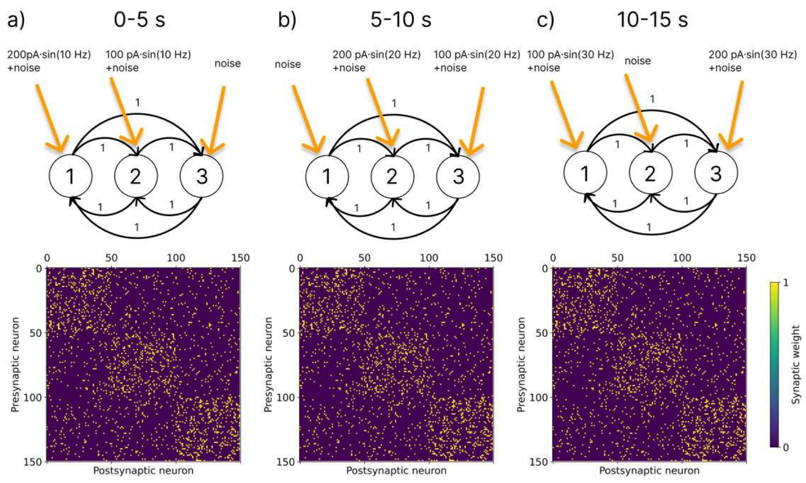
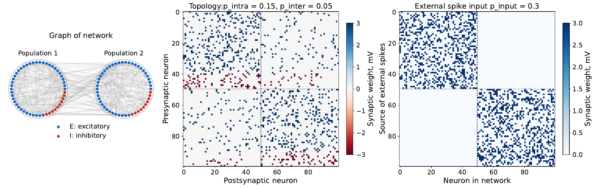
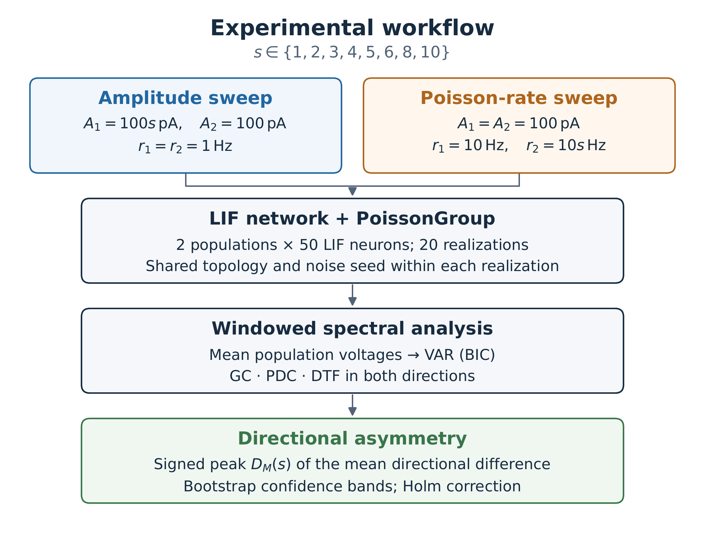
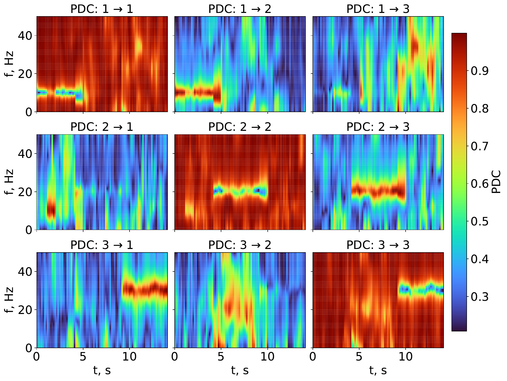
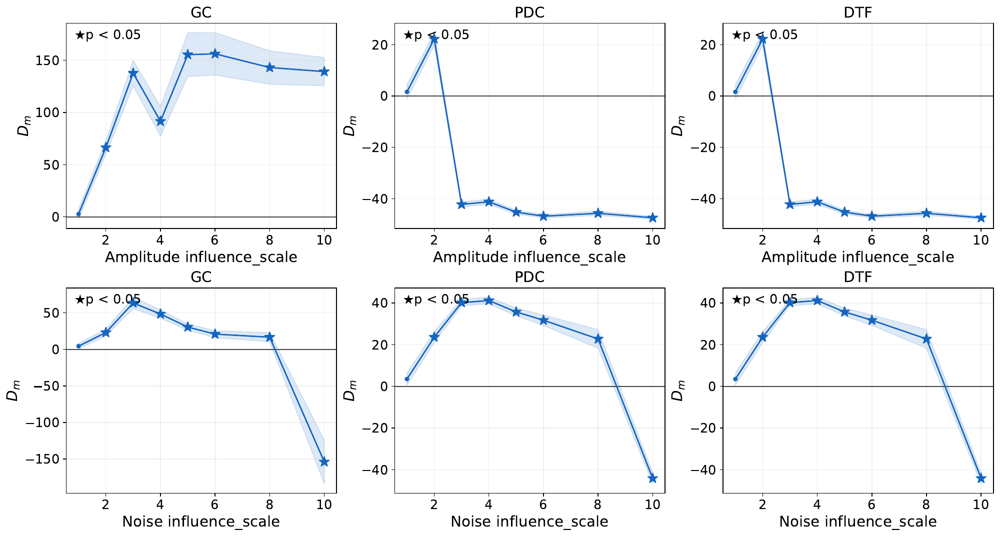
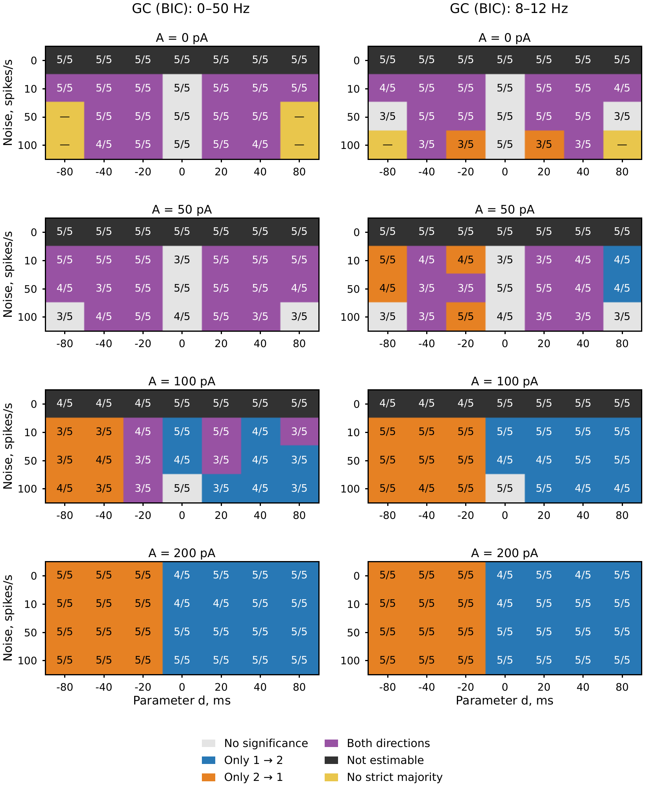
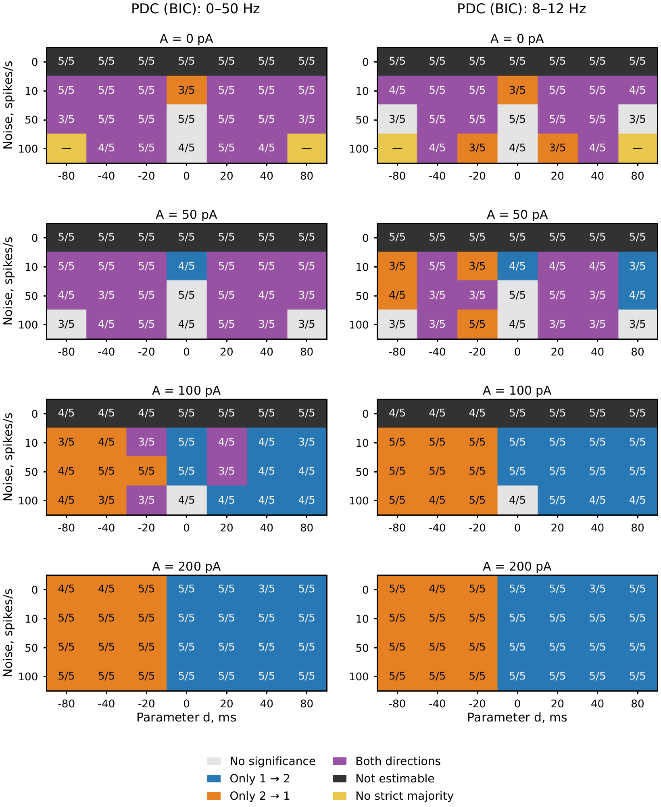

# Controlling directed interactions between spiking neural populations by changing external excitation

This repository studies directed interactions in LIF neural networks under changing
external excitation and fixed synaptic topology. Networks are simulated in Brian2
and analyzed using spectral Granger causality (GC), partial directed coherence (PDC),
and the directed transfer function (DTF). The code accompanies the study
by B. B. Batuev and S. V. Sukhov.

## Installation and usage

```bash
python3 -m pip install numpy scipy matplotlib brian2 networkx cython
```

Run commands from the repository root. Cython requires a C/C++ compiler;
use `--backend numpy` in Experiment 3 to run without compilation.

| Script | Experiment |
| --- | --- |
| [experiment1.py](experiment1.py) | Three populations of 50 neurons; stimulation switches at 10 → 20 → 30 Hz, PDC spectrograms |
| [experiment2.py](experiment2.py) | Two populations; separate sweeps of current amplitude and Poisson input rate, 20 realizations, bootstrap inference |
| [experiment3/systematic_analysis.py](experiment3/systematic_analysis.py) | Harmonic-current amplitude, Poisson rate, and delay sweep; 560 simulations, spike count analysis, phase surrogates |
| [experiment3/save_spectrogram.py](experiment3/save_spectrogram.py) | Windowed GC/PDC/DTF spectrograms for one parameter combination |
| [experiment3/check_negative_delay.py](experiment3/check_negative_delay.py) | Isolated diagnostic comparing direct assignments of positive and negative synaptic delay in Brian2 |

```bash
python3 experiment1.py
python3 experiment2.py
python3 experiment3/systematic_analysis.py \
  --output-dir experiment3/direction_results_harmonic_v2
```

The first script saves figures in the current directory; the second saves them
in `results_brian2_var_style/`. Set parameters for Experiments 1–2 in the code
and for Experiment 3 through command-line arguments (`--help`).

Saved results: [Experiment 1](experiment1_results/),
[Experiment 2](experiment2_results/),
[Experiment 3](experiment3/experiment3_results/).

## Experiment 3

Two reciprocally connected populations contain 50 LIF neurons each
(40 excitatory and 10 inhibitory). A harmonic current
`I(t) = A sin(2π · 10 Hz · t)` with zero initial phase drives one population;
`A` is its peak amplitude. Each population also receives an independent pool
of 50 external Poisson sources, with connection probability 0.3 and a +3 mV
voltage jump per arriving spike. The Poisson rate is specified per source
and is the same in both pools.

The sign of `coupling_delay` selects the stimulated population: nonnegative
values stimulate population 1, and negative values stimulate population 2.
Both inter-population projections remain present, with physical propagation
delay `abs(coupling_delay)` in each direction. Thus, comparing −40 and +40 ms
changes the stimulation target while preserving the physical delay.

The default sweep uses the following settings:

| Parameter | Values |
| --- | --- |
| Peak current amplitude | 0, 50, 100, 200 pA |
| External Poisson rate | 0, 10, 50, 100 Hz per source |
| Signed delay parameter | −80, −40, −20, 0, 20, 40, 80 ms |
| Random seeds | 0, 1, 2, 3, 4 |
| Recording duration | 10 s, starting at simulation onset; no discarded warm-up |
| Integration step / spike-count interval | 0.5 ms / 10 ms |
| VAR order | Selected by BIC, up to 20 by default |
| Significance test | 199 phase surrogates, significance level 0.05 |

The grid contains 560 simulations. For a smaller sweep, specify the grid explicitly:

```bash
python3 experiment3/systematic_analysis.py \
  --amplitudes 100 200 --noises 50 --delays-ms -40 40 \
  --seeds 0 1 2 3 4 --workers 4 --backend numpy \
  --output-dir experiment3/custom_results
```

Each recording is standardized before fitting a VAR model to the full record.
Phase surrogates independently randomize the Fourier phases of the two channels
while preserving their power spectra. The VAR coefficients are refitted for each
surrogate with the order selected for the original recording. The test uses
the maximum over all frequencies and both directions, with a Bonferroni correction
across GC, PDC, and DTF. The same global thresholds are used for the 8–12 Hz band.

### Direction maps and saved results

The sweep saves `manifest.json` (settings and source hashes), `runs.csv`
(per-seed categories), per-run caches in `runs/`, and six maps:

| Frequency range | Files |
| --- | --- |
| Full range, 0–50 Hz | `direction_GC.png`, `direction_PDC.png`, `direction_DTF.png` |
| Rhythm band, 8–12 Hz | `direction_10Hz_GC.png`, `direction_10Hz_PDC.png`, `direction_10Hz_DTF.png` |

Each map cell requires a strict majority of all configured seeds (five by default).
Blue means only
1 → 2 is significant; orange means only 2 → 1; purple means both directions;
light gray means no significance; black means estimation was not possible;
yellow means no category has a strict majority. A label such as `4/5` counts
realizations in the majority category, including when that category is no
significance or estimation failure.

Regenerate the six maps from the included `manifest.json` and `runs.csv`
without running simulations or importing Brian2:

```bash
python3 experiment3/systematic_analysis.py --report-only \
  --output-dir experiment3/experiment3_results
```

Per-run caches in `runs/` directories are excluded from Git. Repeating a local
run with identical settings and source code reuses completed caches. Choose
a new `--output-dir` when changing sweep settings or source code. The included
aggregated results can be redrawn without the caches, but do not supply the
per-run caches needed to resume simulations.

### Spectrogram for one condition

```bash
python3 experiment3/save_spectrogram.py \
  --amplitude 200 --delay-ms 40 --noise 50 --seed 0 \
  --duration 10 --window 2 --step 0.16 \
  --output-dir experiment3/spectrogram_results
```

This saves a PNG with both directions for all three metrics and an NPZ containing
spike counts, spectra, window times, and metadata. The VAR order is selected by
BIC on the full recording; coefficients are then refitted in each window.
The window length must not exceed the recording duration and must provide
enough samples for the selected VAR order. Time coordinates mark window centers,
so the plotted time range does not extend to both ends of the recording.

Spectrogram colors show metric values without a window-level significance test.
Direction maps use surrogate tests on the full recording and aggregate five seeds;
a bright spectrogram band alone does not imply a significant map cell.

To run the separate direct-delay diagnostic:

```bash
python3 experiment3/check_negative_delay.py
```

It saves `direct_delay_comparison.png` and `direct_delay_comparison.npz` in
`experiment3/negative_delay_check/`. This diagnostic assigns ±40 ms directly
to a Brian2 synapse; the sweep instead uses the signed parameter convention
described above.

## Figures from the paper

All eight figures appear in the same order as in the paper, converted from the original PDFs to PNG.

**Figure 1.** Switching external excitation among three populations.



**Figure 2.** Network topology, neuron types, and external projections for two populations.



**Figure 3.** Workflow for sweeping current amplitude and Poisson input rate.



**Figure 4.** PDC spectrograms during stimulation switching among three populations.



**Figure 5.** Signed peaks of GC, PDC, and DTF asymmetry across 20 realizations;
shading shows confidence bands, and stars indicate significance after Holm correction.



**Figure 6.** GC directionality over 0–50 Hz (left) and 8–12 Hz (right);
each category requires a strict majority of five realizations.



**Figure 7.** PDC directionality over the full frequency range and within the rhythm band.



**Figure 8.** DTF directionality. With the bivariate normalizations used here,
DTF and PDC coincide, so matching maps do not provide independent confirmation.


## Interpretation

In the amplitude series of Experiment 2, PDC/DTF asymmetry reverses sign while
GC asymmetry remains positive. In the saved Experiment 3 results, significant
unidirectional outcomes at 100 and 200 pA follow the stimulated population
within the 8–12 Hz band. Detection depends on delay and Poisson input;
increasing amplitude from 100 to 200 pA does not improve every condition.
All 140 recordings without Poisson input are non-estimable; all 420 recordings
with nonzero Poisson input are estimable. Estimability alone does not imply
statistical significance.

These metrics describe statistical dependencies between signals. The highest noise
level in Experiment 2 saturates the discrete `PoissonGroup` generator;
the sign of the delay parameter in Experiment 3 also selects the stimulated population.

Code license: [GNU AGPL v3.0](LICENSE).
